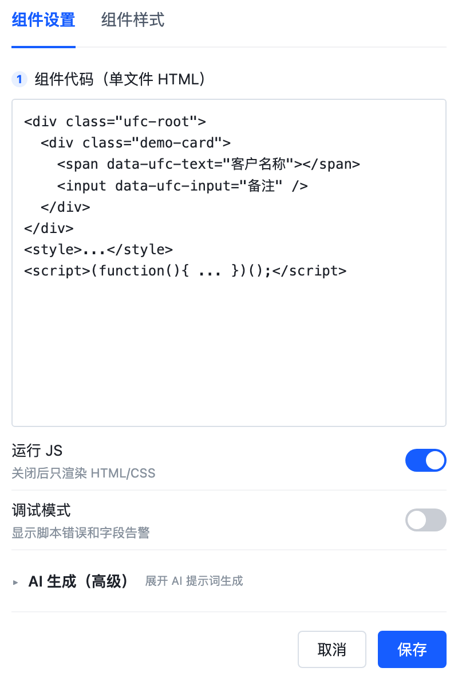
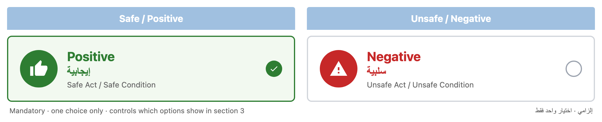

# Ones 万能组件（e10-ones-ufc）

  

> **为需求而生，为通用立命，让组件变成任何你想要的样子～**

**Ones 万能组件是一个 E10 表单组件，不是 EB 页面组件。**
它从表单设计器的「组件管理 → 新建组件 → 从空白创建」创建，拖入的是表单设计器，不是 e-builder 页面设计器。

管理员在组件配置里粘贴单文件 HTML（可含 `<style>` / `<script>`），组件在表单运行态用 Shadow DOM 渲染；脚本通过统一的 `ctx` 桥接读写当前表单字段，不依赖平台内部组件实现。配置里还内置了「AI 提示词生成」，可以直接把需求 + 字段上下文 + API 契约复制给任意 AI，生成代码后粘回来。

## 界面





## 它解决什么问题

- 业务表单里总有一些「平台标准字段拼不出来」的 UI：卡片、时间轴、指标块、联动面板、特殊选择器。
- 每个需求都写一次 ecode、发一次版，成本高、周期长。
- 直接写页面组件又拿不到表单字段上下文，或者把表单页面搞得很重。

Ones 万能组件把「HTML/CSS/JS 的自由」留给管理员和 AI，把「字段读写、只读、必填、初始值、明细、错误兜底」收进组件桥接层。

## V1 能力

- **一个代码框**：单文件 HTML，可含 `<style>` / `<script>`；自动剥离 `html/head/body`，在 Shadow DOM 渲染。
- **字段桥接 `ctx`**：`get / obj / text / set / setObj / attr / field / fields / label / on / onAttr / onReady / onBeforeSave / onSave / onLinkage / onRelate / rows / request / toast / confirm / refresh / onDestroy / raw`。
- **声明式绑定**：`data-ufc-text / data-ufc-input / data-ufc-label / data-ufc-show / data-ufc-if-readonly / data-ufc-if-edit / data-ufc-if-required / data-ufc-if-hidden / data-ufc-empty / data-ufc-format / data-ufc-live / data-ufc-row`。
- **字段状态**：只读、必填、隐藏、可编辑；明细字段强制 `rowId`，避免误写所有行。
- **选项显示**：固定选项从字段 options 映射名称；写值支持 valueKey / selectionId，按字段实际契约选择。
- **初始值**：只从运行数据读取，不写死示例；等表单就绪后刷新，联动/钻取后自动更新。
- **AI 提示词**：内置模板 + 需求 + 字段清单，一键生成/复制；AI 面板默认折叠。
- **工程化**：设计态静态渲染（不执行脚本）；运行 JS 开关；调试模式；hook 去重；构建/导入链路完整。

## 快速开始

1. 在目标 E10 环境创建空白表单组件（表单设计器 → 组件管理 → 新建组件 → 从空白创建）。
2. 用 ecode 拉取工程，把本仓库根目录的 `View.js / Config.js / Design.js / MView.js / MDesign.js / StyleConfig.js / coms/ / config/ / entry.js` 放进去。
3. 构建并导入：

```bash
ecodecmd-e10 check <project-dir>
ecodecmd-e10 compile <project-dir>
ecodecmd-e10 build <project-dir>
ecode-cli package import --file <project-dir>/.target/<appId>.zip --project-id <ecode-project-id>
```

4. 在表单设计器「自定义 / 默认」拖入 `Ones 万能组件`。
5. 右侧配置：
   - `组件代码（单文件 HTML）`：粘贴代码；
   - `运行 JS`：默认开；
   - `调试模式`：排障时开；
   - `AI 生成（高级）`：默认折叠，展开后填需求并生成提示词。

## 单文件代码约定

- 组件在 Shadow DOM 中运行，CSS 用 `:host` 承载变量；`body` 样式写在 `.ufc-root` 上。
- 组件内部查节点用 `ctx.root.querySelector`，不要用 `document.querySelector`（Shadow DOM 查不到）。
- 固定选项写值前用 `ctx.obj` / 字段配置确认可识别值：可能是 valueKey（如 `0/1`），也可能是 selectionId。
- 明细字段读写必须带 `rowId`：`ctx.set('明细字段', value, { rowId })`。
- 只读/隐藏/打印态用 `ctx.attr` 或 `data-ufc-if-*` 判断，不要硬编码。
- 用户数据一律 `textContent` / `ctx.text`，不要拼 `innerHTML`。

最短示例：

```html
<div class="ufc-root">
  <span data-ufc-text="客户名称" data-ufc-empty="—"></span>
  <input data-ufc-input="备注" />
  <button data-ufc-if-edit="客户名称">把名称写入备注</button>
</div>
<script>
(function(){'use strict';var b=ctx.root.querySelector('button');if(!b)return;b.addEventListener('click',function(){ctx.set('备注',ctx.text('客户名称'))})})();
</script>
```

## 示例

- [`examples/observation-type.html`](examples/observation-type.html)：Safe / Positive vs Unsafe / Negative 双卡片选择器，绑定 `obstyp` 的 `0/1`，保持原始视觉，无外边框。
- 默认配置里的 `Ones 示例卡片`：字段文本、输入写回、只读隐藏按钮。

## 目录

```
.
├─ Config.js               # 配置项：代码 / 运行JS / 调试 / AI 高级（折叠）
├─ Design.js / MDesign.js  # 设计态：静态 HTML/CSS，不执行脚本
├─ View.js / MView.js      # 运行态：Shadow DOM + 脚本 + 声明式绑定
├─ StyleConfig.js          # 组件样式面板
├─ coms/
│  ├─ defaults.js          # 默认配置 + 示例
│  ├─ renderer.js          # HTML 归一化、Shadow DOM、脚本执行、错误兜底
│  ├─ bridge.js            # WeFormSDK / formStore 适配、字段解析、ctx
│  ├─ bindings.js          # data-ufc-* 声明式绑定
│  ├─ prompt.js            # 内置 AI 提示词模板
│  └─ ai-config.js         # 折叠式 AI 面板（系统风格）
├─ docs/
│  ├─ architecture.md
│  ├─ ai-prompt.md
│  └─ test-report.md
├─ examples/
│  └─ observation-type.html
├─ build.json              # 脱敏模板（appId/appUUID 为空）
├─ config/                 # 平台配置占位（空）
├─ entry.js                # 必须存在且为空
└─ resources/
```

## 实测范围

已在 E10 目标环境验证：Shadow DOM 渲染、`data-ufc-*` 绑定、字段读写、只读拦截、固定选项显示/写值、明细行读取/写入、缺 `rowId` 抛错、保存前置校验、配置保存重开、构建/导入。

未完成实测：打印模板场景、整表单只读、真实移动端 H5、超大配置体积、多实例压力。详见 [`docs/test-report.md`](docs/test-report.md)。

## 安全

- 组件会执行管理员配置的 JS，信任边界等同平台「页面源码 / 表单 ecode」；不要把它开放给不可信的低权限编辑者。
- 字段值、用户输入、接口返回永远不要拼进 HTML 字符串或 `eval`；用 `textContent` / `ctx.text`。
- 外链脚本/样式只允许必要的 https 域名。
- 正式发布前请按你们的 `ecode-security-review` 流程确认直出/沙箱策略。

## 版本

- **v1.0.0**（2026-10-21）：首个版本。表单组件、Shadow DOM 渲染、`ctx` 字段桥接、`data-ufc-*`、AI 提示词、明细 `rowId`、hook 去重、保存前校验。


---

Made with care by **Ones** · 为需求而生，为通用立命。
